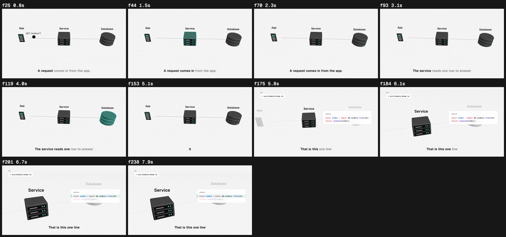

# video-kit

A skill that lets a coding agent make narrated 3D explainer videos: of a pull request, a bug and its fix, a plan, or how a system works.

You ask in plain words. The agent writes the script, narrates it, builds the scene from React components ([Remotion](https://www.remotion.dev) and React Three Fiber), checks its own frames, and renders an MP4.



## Install

Clone it where your agent looks for skills, and install its packages once:

```bash
git clone https://github.com/ruanmartinelli/video-kit ~/.claude/skills/video-kit
```

```bash
cd ~/.claude/skills/video-kit && pnpm install
```

It needs Node 24, [pnpm](https://pnpm.io) and [uv](https://docs.astral.sh/uv/) (narration runs a small Python script). The first render downloads a headless browser.

`SKILL.md` is plain Markdown, so an agent that has no skill loader can be pointed at the file.

## Use

Ask for a video in the project you are working in:

> Make a video that explains this pull request to its reviewer.

> Explain this bug and the fix in a video. I'm new to this codebase.

The agent creates the video as a folder in that project, `videos/<name>/` unless you say otherwise, and renders `videos/<name>/out/<name>.mp4`. Nothing about your project is written into video-kit.

## How a video is made

A video is a beat sheet: one spoken sentence per beat, and one thing changing on screen while it is spoken.

| Step | What happens | Command |
|---|---|---|
| Write | `script.json`: a voice and a list of beats | |
| Narrate | One MP3 per beat, with the time of every word | `pnpm narrate <folder>` |
| Compose | One React file: a timeline, a graph, a camera, panels | |
| Check | Types, then cue frames tiled twelve to an image | `pnpm check <folder>`, `pnpm stills <folder> cues --sheet` |
| Render | `out/<name>.mp4` | `pnpm render <folder>` |

`pnpm storyboard <folder>` puts a few frames on one sheet with a note under each, for presenting the video yourself.

Commands run from the video-kit folder and take the path to the video's folder.

## What is in it

- **`SKILL.md`**: the method an agent follows.
- **`references/`**: how each kind of video goes, and one page per piece with its props and an example. There are 35 pieces: nodes in 22 shapes, packets, pipes, gates, callouts, a camera rig, and flat panels for code, tables, records, timelines, meters and more.
- **`template/`**: a three-beat video every new one starts from.
- **`src/kit/`**: the pieces.
- **`scripts/`**: narrate, check, stills, render, storyboard.

The kit does part of the checking itself: a label the frame edge would cut is hidden, and labels that would overlap stop the render with an error that says what to change.

## Privacy

`pnpm narrate` sends each sentence of the script to Microsoft's Edge text-to-speech service. It is an unofficial endpoint that throttles bursts; the script waits it out. The skill tells the agent to keep names of customers and people, and credentials, out of the narration. Everything else runs on your machine.

## Changing the kit

`AGENTS.md` has the rules for adding a piece or a shape. `pnpm test` typechecks, checks that the reference pages are current, and renders the template's frames.

Remotion has its own license terms. Check them before using this at a company.
